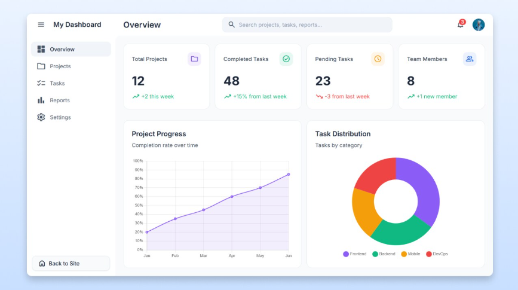
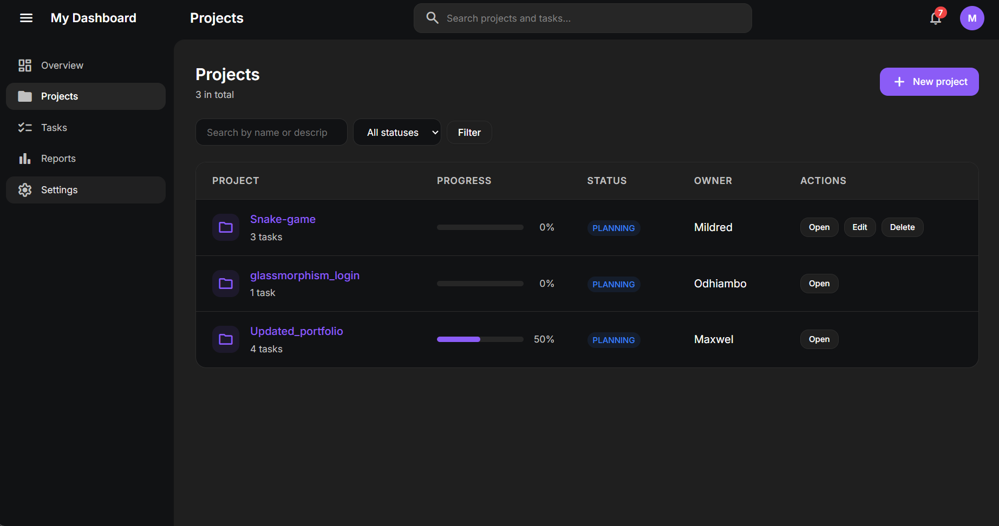
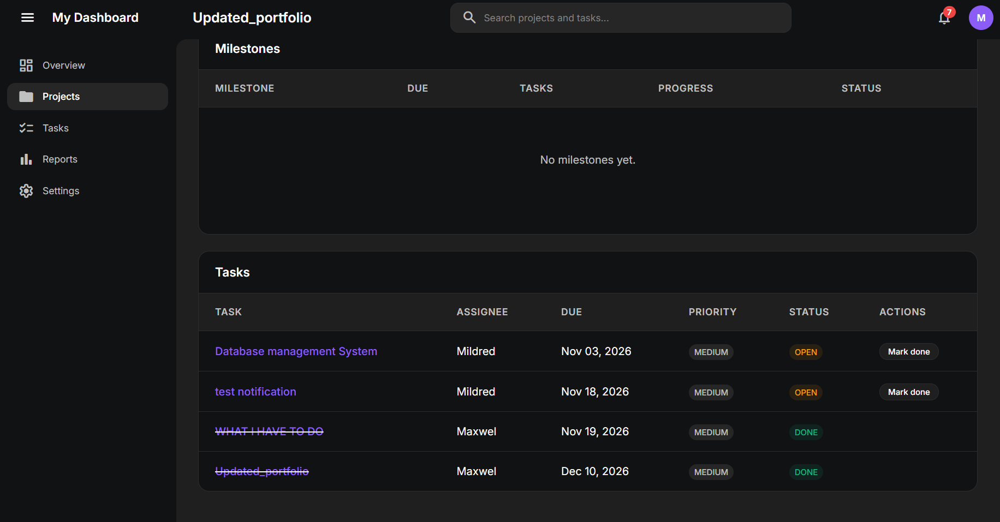
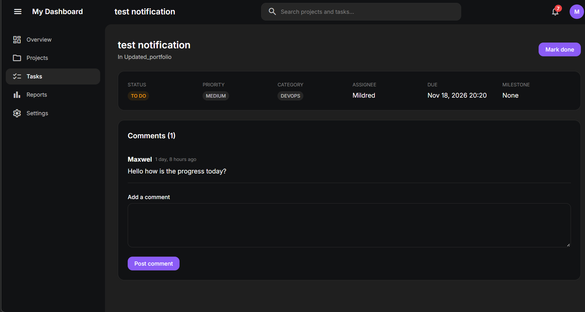
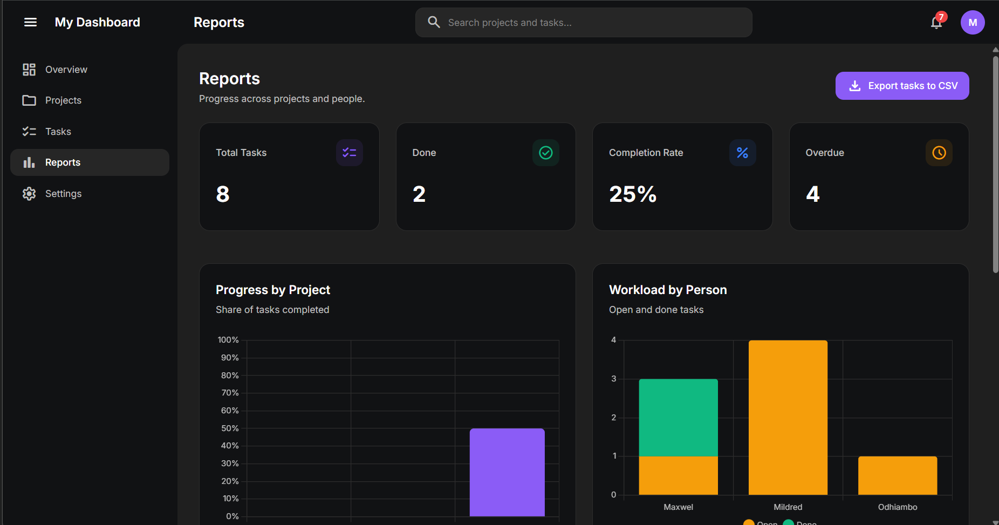
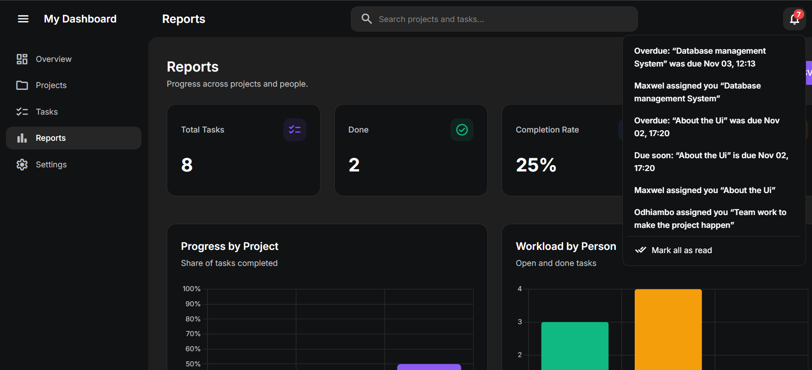
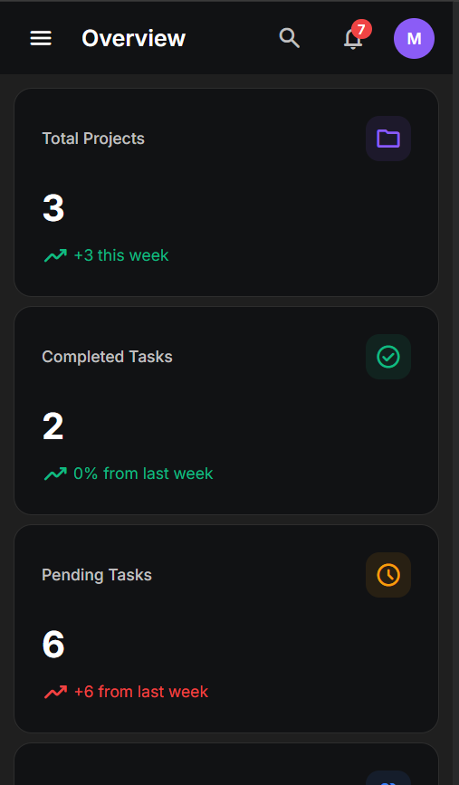

# Project Hub: Admin Dashboard

A centralised dashboard for managing projects and their tasks, built with Django. It gives you one place to see what's in progress, what's overdue, and how your team is doing, with light and dark themes, charts, search, comments, milestones and notifications. Every person only sees the work they are involved in.



---

## Table of contents

1. [Features](#features)
2. [Screenshots](#screenshots)
3. [Tech stack](#tech-stack)
4. [Project structure](#project-structure)
5. [Getting started](#getting-started)
6. [Using the dashboard](#using-the-dashboard)
7. [Who can do what](#who-can-do-what)
8. [How the numbers are calculated](#how-the-numbers-are-calculated)
9. [Notifications and reminders](#notifications-and-reminders)
10. [Data model](#data-model)
11. [URL reference](#url-reference)
12. [Configuration](#configuration)
13. [Deployment](#deployment)
14. [Security notes](#security-notes)
15. [Troubleshooting](#troubleshooting)
16. [Roadmap](#roadmap)
17. [Contributing](#contributing)
18. [License](#license)

---

## Features

**Overview page**

- Four summary cards: Total Projects, Completed Tasks, Pending Tasks, and Team Members, each with a trend against last week.
- Line chart of the share of tasks completed, by month, over the last six months.
- Doughnut chart of tasks by category (Frontend, Backend, Mobile, DevOps).
- Recent Projects table with progress, status badge, and owner.

**Project and task management**

- Create, view, edit, and delete projects, with search, status filter, and pagination.
- Project page with description, owner, status, progress, milestones, and a task table.
- Create, edit, delete, and complete tasks with category, priority, assignee, and due date.
- Task page with all the details and a comment thread.
- Task list filters: search, open or completed, category, project, and "assigned to me".
- Project progress is calculated automatically from completed tasks.

**Milestones**

- Add checkpoints to a project, such as "Beta release", each with a due date.
- Link tasks to a milestone and see how many of them are done, with a progress bar.
- Mark a milestone as reached or reopen it.

**Comments**

- A discussion thread on every task.
- The assignee and the project owner are notified of new comments.
- Authors can delete their own comments, and project owners can delete any comment on their projects.

**Notifications and reminders**

- Notification bell with an unread badge and a "Mark all as read" button.
- You are notified when a task is assigned or reassigned to you, and when someone comments on your task or project.
- Automatic "Due soon" and "Overdue" reminders, sent once per task and due date.

**Accounts and permissions**

- Sign up, log in, log out, and reset a forgotten password by email.
- People see only the projects they own or have a task in. Only project owners can change them.
- Profile editing and a team list on the Settings page.
- Login protection on every dashboard page, plus the built-in Django admin at `/admin/` for staff.

**Reports and search**

- Summary cards for total tasks, completed tasks, completion rate, and overdue count.
- Progress-by-project and workload-by-person charts.
- Overdue tasks table.
- One-click CSV export of the tasks you can see.
- Global search across projects and tasks.

**Everyday conveniences**

- Light and dark theme, remembered between visits.
- Collapsible sidebar and a layout that works on phones.

## Screenshots

| | |
| --- | --- |
|  |  |
| **Projects list** | **Project page with milestones and tasks** |
|  |  |
| **Task page with comments** | **Reports** |
|  |  |
| **Notifications and reminders** | **Phone layout** |

## Tech stack

| Layer    | Choice                                                         |
| -------- | -------------------------------------------------------------- |
| Backend  | Python 3, Django 5.2 (8 or newer for Python 3.14)              |
| Database | MySQL, through `mysqlclient`                                   |
| Styling  | style.css and extras.css, Inter font via Google Fonts          |
| Icons    | Google Material Symbols                                        |
| Charts   | Chart.js via CDN                                               |
| Auth     | Django's built-in authentication, with sign-up and password reset |

There is no JavaScript build step. The CDN assets mean the browser needs internet access.

## Project structure

```text
admin-dashboard/
├── core/
│   ├── __init__.py
│   ├── asgi.py
│   ├── settings.py
│   ├── urls.py
│   └── wsgi.py
├── dashboard/
│   ├── migrations/
│   ├── static/
│   │   ├── css/
│   │   │   ├── style.css
│   │   │   └── extras.css
│   │   ├── documents/
│   │   ├── images/                 # screenshots used in this README
│   │   └── js/
│   │       └── script.js
│   ├── templates/
│   │   ├── accounts/               # sign-up and password-reset pages
│   │   ├── projects/               # dashboard, lists, detail, reports, settings, search
│   │   ├── registration/
│   │   │   └── login.html
│   │   ├── base.html
│   │   ├── confirm_delete.html
│   │   └── form.html
│   ├── __init__.py
│   ├── account_urls.py             # login, logout, sign-up, password reset
│   ├── admin.py
│   ├── apps.py
│   ├── context_processors.py       # notification count and the reminder check
│   ├── forms.py
│   ├── models.py
│   ├── permissions.py              # who can see and change what
│   ├── reminders.py                # due-soon and overdue reminders
│   ├── tests.py
│   ├── urls.py
│   └── views.py
├── .env.example
├── .gitignore
├── LICENSE
├── manage.py
├── README.md
└── requirements.txt
```

## Getting started

### Prerequisites

- Python 3.10 or newer
- A running MySQL server
- `pip` and `venv` (included with Python)
- An internet connection when viewing the dashboard (for the CDN assets)

### Installation

```bash
# 1. Get the code and enter the folder
git clone <https://github.com/Maxwel12744/admin-dashboard.git>
cd admin-dashboard

# 2. Create and activate a virtual environment
python -m venv venv
source venv/bin/activate          # Windows: venv\Scripts\activate

# 3. Install dependencies
pip install -r requirements.txt

# 4. Create the MySQL database (run this in the MySQL shell)
#    CREATE DATABASE your_db_name CHARACTER SET utf8mb4;

# 5. Add your settings
cp .env.example .env              # Windows: copy .env.example .env
#    then open .env and fill in the values it lists

# 6. Create the database tables
python manage.py migrate

# 7. Create your admin account
python manage.py createsuperuser

# 8. Start the development server
python manage.py runserver
```

Open <http://127.0.0.1:8000/> and sign in with the account you just created. New people can register at `/accounts/signup/`.

If you add packages later, record them with `pip freeze > requirements.txt`.

### Emails in development

Password-reset emails are printed in the terminal where the server runs, so nothing is really sent. Before going online, replace `EMAIL_BACKEND` in `settings.py` with SMTP details from your email provider.

## Using the dashboard

### Adding a project

1. Click **Projects** in the sidebar, then **New project**.
2. Fill in the name, category, status, and dates. Repository and live-site URLs are optional.
3. Click **Save**. You land on the project's page. You become its owner. Superusers can choose a different owner.

### Adding tasks

1. On a project's page, click **Add task**.
2. Choose a category, priority, assignee, due date, and optionally a milestone.
3. Click **Mark done** next to a task to complete it. Click **Reopen** to undo.

The project's progress bar and the Overview charts update as tasks are completed.

### Adding milestones

1. On a project's page, click **Add milestone** and give it a title and a due date.
2. Edit a task and choose the milestone to link it.
3. The Milestones table shows how many linked tasks are done. Use **Mark reached** when the milestone is complete.

### Commenting on a task

Click a task's title to open its page, write a note in the comment box, and click **Post comment**. The assignee and the project owner are notified.

### Working with others

1. People can create their own account at `/accounts/signup/`, or you can create accounts in `/admin/`.
2. Assign tasks to them. They receive a notification on the bell icon and can open the task from it.
3. Use the **Assigned to me** filter on the Tasks page to see your own work.

### Resetting a password

Click **Forgot your password?** on the login page and enter your email address. A link to choose a new password is sent to that address.

### Theme and account

Click your avatar in the top right to switch between Light and Dark, open your profile, or sign out. Staff users also see an **Admin site** button in the sidebar.

### Exporting data

Open **Reports** and click **Export tasks to CSV** for a spreadsheet-friendly export of every task you can see.

## Who can do what

| Action                                   | Project owner | Person assigned a task | Other users | Superuser |
| ---------------------------------------- | ------------- | ---------------------- | ----------- | --------- |
| See the project and its tasks            | Yes           | Yes                    | No          | Yes       |
| Edit or delete the project               | Yes           | No                     | No          | Yes       |
| Add, edit, or delete tasks and milestones | Yes          | No                     | No          | Yes       |
| Mark their task done or reopen it        | Yes           | Yes                    | No          | Yes       |
| Comment on a task                        | Yes           | Yes                    | No          | Yes       |
| Delete a comment                         | Any comment   | Their own              | No          | Yes       |

A page the person is not allowed to see answers with "Not Found", so a project's existence is not revealed to people outside it. The Overview, Reports, Search, and CSV export only count what you can see.

## How the numbers are calculated

| Item                                | Definition                                                                                                                                           |
| ----------------------------------- | ---------------------------------------------------------------------------------------------------------------------------------------------------- |
| Project progress                    | Completed tasks ÷ total tasks. With no tasks, a "Completed" project shows 100%; otherwise the manual percentage is used.                             |
| Total Projects, "+N this week"      | The projects you can see, and how many were created in the last 7 days.                                                                              |
| Completed Tasks, "% from last week" | Your completed tasks, and the change in tasks completed in the last 7 days compared with the 7 days before. Shows 0% when the previous week had none. |
| Pending Tasks, "N from last week"   | Open tasks now, minus the number that were open a week ago. A falling number is shown in green.                                                      |
| Team Members                        | Active user accounts, and how many joined in the last 7 days.                                                                                        |
| Project Progress chart              | For each of the last six months: of all tasks created by the end of that month, the percentage that had been completed by then.                      |
| Task Distribution                   | Task counts per category. Categories with no tasks are left out.                                                                                     |
| Overdue                             | Open tasks whose due date has passed.                                                                                                                |
| Milestone progress                  | Linked tasks that are done ÷ linked tasks. With no linked tasks, a reached milestone shows 100%.                                                     |

## Notifications and reminders

| You are notified when…                                  | Who receives it                           |
| ------------------------------------------------------- | ----------------------------------------- |
| A task is created with you as the assignee               | The assignee                              |
| A task's assignee is changed to you                      | The new assignee                          |
| Someone comments on a task                               | The assignee and the project owner, but not the author |
| An open task is due within the next 24 hours             | The assignee ("Due soon")                 |
| An open task passed its due date in the last 7 days      | The assignee ("Overdue")                  |

Tasks with no assignee send their reminders to the project owner. Nobody is notified about their own actions.

**How reminders work.** When someone opens a page, the app checks their open tasks, at most once every 10 minutes. Each reminder is sent once. The message includes the due date, so changing a task's due date sends a new reminder. Reminders are created when a person uses the site, so they do not need a scheduler.

## Data model

**Project**: `name`, `description`, `category`, `status` (planning, in progress, on hold, completed), `owner`, `start_date`, `deadline`, `manual_progress`, `repo_url`, `live_url`, `created_at`, `updated_at`

**Milestone**: `project`, `title`, `due_date`, `is_completed`

**Task**: `project`, `milestone`, `title`, `description`, `category`, `status`, `priority` (low, medium, high), `assignee`, `is_done`, `due_date`, `created_at`, `completed_at`. `completed_at` and `status` are set and cleared automatically when a task is completed or reopened.

**Comment**: `task`, `author`, `content`, `created_at`

**Notification**: `user`, `message`, `link`, `is_read`, `created_at`

Deleting a project deletes its tasks and milestones, and deleting a task deletes its comments. Deleting a milestone keeps its tasks. Deleting a user deletes the projects they own, and the tasks assigned to them become unassigned.

## URL reference

All routes require login, except the account pages (login, sign-up, and password reset).

| Path                                    | Name                  | Purpose                                  |
| --------------------------------------- | --------------------- | ---------------------------------------- |
| `/`                                     | `dashboard`           | Overview                                 |
| `/projects/`                            | `project_list`        | List, search, filter                     |
| `/projects/new/`                        | `project_create`      | New project                              |
| `/projects/<id>/`                       | `project_detail`      | Project, milestones, and tasks           |
| `/projects/<id>/edit/`                  | `project_update`      | Edit project                             |
| `/projects/<id>/delete/`                | `project_delete`      | Delete project                           |
| `/projects/<id>/milestones/new/`        | `milestone_create`    | New milestone                            |
| `/milestones/<id>/edit/`                | `milestone_update`    | Edit milestone                           |
| `/milestones/<id>/delete/`              | `milestone_delete`    | Delete milestone                         |
| `/milestones/<id>/toggle/`              | `milestone_toggle`    | Mark reached or reopen (POST only)       |
| `/tasks/`                               | `task_list`           | List and filter tasks                    |
| `/tasks/new/`                           | `task_create`         | New task (`?project=<id>` preselects)    |
| `/tasks/<id>/`                          | `task_detail`         | Task details and comments                |
| `/tasks/<id>/edit/`                     | `task_update`         | Edit task                                |
| `/tasks/<id>/delete/`                   | `task_delete`         | Delete task                              |
| `/tasks/<id>/toggle/`                   | `task_toggle`         | Complete or reopen (POST only)           |
| `/tasks/<id>/comment/`                  | `comment_add`         | Post a comment (POST only)               |
| `/comments/<id>/delete/`                | `comment_delete`      | Delete a comment (POST only)             |
| `/reports/`                             | `reports`             | Charts and overdue list                  |
| `/reports/export/`                      | `report_export`       | CSV download                             |
| `/settings/`                            | `settings_page`       | Profile and team                         |
| `/search/?q=`                           | `search`              | Search projects and tasks                |
| `/notifications/read/`                  | `notifications_read`  | Mark all read (POST only)                |
| `/accounts/login/`, `/accounts/logout/` | `login`, `logout`     | Authentication (log out is POST only)    |
| `/accounts/signup/`                     | `signup`              | Create an account                        |
| `/accounts/password_reset/`             | `password_reset`      | Ask for a password-reset email           |
| `/accounts/reset/<uid>/<token>/`        | `password_reset_confirm` | Choose a new password                 |
| `/admin/`                               |                       | Django admin                             |

## Configuration

Settings are read from environment variables, with development-friendly defaults.

| Variable                      | Default                       | Purpose                                                                            |
| ----------------------------- | ----------------------------- | ---------------------------------------------------------------------------------- |
| `DJANGO_SECRET_KEY`           | an insecure development value | Cryptographic signing key. **Always set your own in production.**                  |
| `DJANGO_DEBUG`                | `1`                           | Set to `0` in production.                                                          |
| `DJANGO_ALLOWED_HOSTS`        | `localhost,127.0.0.1`         | Comma-separated host names the site may serve.                                     |
| `DJANGO_CSRF_TRUSTED_ORIGINS` | empty                         | Comma-separated origins such as `https://example.com`, needed behind some proxies. |

The MySQL connection details (database name, user, password, and host) are also kept in `.env`. Copy `.env.example` to `.env` and fill in the values it lists. Never commit `.env`.

Generate a secret key with:

```bash
python -c "from django.core.management.utils import get_random_secret_key as k; print(k())"
```

## Deployment

> The steps below are a standard Django checklist. This project has not been tested on a production host, so verify each step in a staging environment first.

1. **Set environment variables** from the table above, with `DJANGO_DEBUG=0`.
2. **Use a production MySQL database.** Create it with `utf8mb4`, keep its credentials in environment variables, and run `python manage.py migrate`.
3. **Serve static files.** Set `STATIC_ROOT` in `core/settings.py` and run `python manage.py collectstatic`. Serve the collected folder with Nginx, or add [WhiteNoise](https://whitenoise.readthedocs.io/) to the middleware. The dashboard pages use CDN assets, but the Django admin needs its own static files.
4. **Run a production server**, for example `pip install gunicorn` and `gunicorn core.wsgi`, behind Nginx or a platform such as Render, Railway, or Fly.io.
5. **Set up real email.** Replace the console `EMAIL_BACKEND` with SMTP settings so password-reset links reach people.
6. **Enable HTTPS**, then consider setting `SECURE_SSL_REDIRECT`, `SESSION_COOKIE_SECURE`, and `CSRF_COOKIE_SECURE` to `True`.
7. **Run the checks:** `python manage.py check --deploy`.
8. **Back up** the database regularly.

## Security notes

- **Access is limited by ownership.** People see only the projects they own or have a task in, and only owners can edit or delete them. Superusers can see and change everything, so keep the number of superuser accounts small. For stricter roles, add Django Groups and permission checks to the views.
- **Sign-up is open.** Anyone who can reach the site can create an account. For a private deployment, remove the `signup` route from `dashboard/account_urls.py`.
- **Never deploy with the defaults.** Set a real secret key, turn debug off, and remove any test accounts.
- State-changing actions (completing a task, commenting, signing out, marking notifications read) use POST requests with CSRF protection.
- Redirects after those actions only go to addresses on your own site.
- Passwords are hashed by Django, and password-reset links expire. Use strong passwords for every account.

## Troubleshooting

| Problem                                                    | Likely cause and fix                                                                                                                                                                      |
| ---------------------------------------------------------- | ----------------------------------------------------------------------------------------------------------------------------------------------------------------------------------------- |
| `ModuleNotFoundError: No module named 'django'`            | The virtual environment isn't active. Run `source venv/bin/activate` (Windows: `venv\Scripts\activate`).                                                                                  |
| `TemplateDoesNotExist`                                     | A template is in the wrong folder. `base.html`, `form.html`, and `confirm_delete.html` live in `dashboard/templates/`, the page templates in `templates/projects/`, and the sign-up and reset pages in `templates/accounts/`. Check that `"dashboard"` is in `INSTALLED_APPS` and `APP_DIRS` is `True`. |
| `ModuleNotFoundError: dashboard.context_processors`        | `dashboard/context_processors.py` is missing, or the name in `TEMPLATES` is misspelled.                                                                                                   |
| `Unknown column '...' in 'where clause'`                   | The database is behind your models. Run `python manage.py migrate`.                                                                                                                       |
| `'super' object has no attribute 'dicts'` in the admin     | Your Django version is too old for your Python version (a known problem with Python 3.14). Upgrade with `pip install --upgrade "Django>=5.2.8,<5.3"`.                                     |
| `Invalid block tag ... 'endblock'` right after saving      | A code formatter such as Prettier split a template tag over two lines. Turn off format-on-save for HTML templates and restore the file.                                                   |
| One page shows another page's content                      | The wrong code was pasted into that template, or into an included file such as `_progress.html` or `_pager.html`. Check the page title line at the top of the file.                        |
| `no such table` or `Table ... doesn't exist`               | Run `python manage.py migrate`.                                                                                                                                                           |
| Page looks unstyled, charts are empty                      | The browser can't reach the CDNs. Check your internet connection or ad blocker.                                                                                                           |
| Sign out shows "method not allowed"                        | Sign out must be a POST form (the avatar menu does this). Don't link to `/accounts/logout/` directly.                                                                                     |
| A page shows "Not Found" for a project you know exists     | You are not its owner and have no task in it. Ask the owner to assign you a task, or sign in as a superuser.                                                                              |
| No password-reset email arrives                            | In development the email is printed in the terminal, not sent. Also check that the account has an email address.                                                                          |
| `DisallowedHost` error                                     | Add your domain to `DJANGO_ALLOWED_HOSTS`.                                                                                                                                                |
| CSRF verification failed behind a proxy                    | Add your site's `https://` address to `DJANGO_CSRF_TRUSTED_ORIGINS`.                                                                                                                      |

## Roadmap

Ideas for future work:

- Automated tests for views, models, and forms
- Role-based permissions beyond owner and assignee (viewer, editor, manager)
- Email notifications for assignments, comments, and reminders
- A scheduled job so reminders are sent even when nobody opens the site
- Bulk import of projects from a CSV file
- Importing repositories from GitHub or GitLab
- Uptime checks for each project's live URL
- File attachments on tasks
- A REST API

## Contributing

1. Fork the repository and create a branch: `git checkout -b feature/my-change`.
2. Make your change and run `python manage.py check`.
3. Commit with a clear message and open a pull request describing what changed and why.

Please keep changes focused, and don't commit `venv/` or secrets. A suggested `.gitignore`:

```
venv/
__pycache__/
staticfiles/
.env
```

## License

This project is released under the terms in the [LICENSE](LICENSE) file.

---

Built with Django.