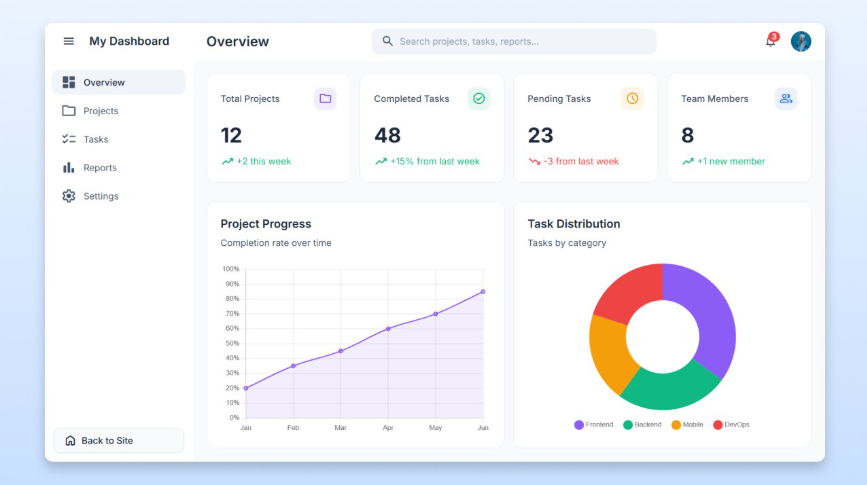

# Project Hub: Admin Dashboard

A centralised dashboard for managing all of my projects and their tasks, built with Django. It gives you one place to see what's in progress, what's overdue, and how your team is doing, with light and dark themes, charts, search, and notifications.



---

## Table of contents

1. [Features](#features)
2. [Tech stack](#tech-stack)
3. [Project structure](#project-structure)
4. [Getting started](#getting-started)
5. [Using the dashboard](#using-the-dashboard)
6. [How the numbers are calculated](#how-the-numbers-are-calculated)
7. [Data model](#data-model)
8. [URL reference](#url-reference)
9. [Configuration](#configuration)
10. [Deployment](#deployment)
11. [Security notes](#security-notes)
12. [Troubleshooting](#troubleshooting)
13. [Roadmap](#roadmap)
14. [Contributing](#contributing)
15. [License](#license)

---

## Features

**Overview page**

- Four summary cards: Total Projects, Completed Tasks, Pending Tasks, and Team Members, each with a trend against last week.
- Line chart of the share of tasks completed, by month, over the last six months.
- Doughnut chart of tasks by category (Frontend, Backend, Mobile, DevOps).
- Recent Projects table with progress, status badge, and due date.

**Project and task management**

- Create, view, edit, and delete projects, with search, status filter, and pagination.
- Project detail page with description, owner, dates, repository and live-site links, and a task checklist.
- Create, edit, delete, and complete tasks with category, priority, assignee, and due date.
- Task list filters: search, open or completed, category, project, and "assigned to me".
- Project progress is calculated automatically from completed tasks.

**Reports**

- Overall completion rate, overdue task count, and active team size.
- Progress-by-project and workload-by-person charts.
- Overdue tasks table.
- One-click CSV export of every task.

**Everyday conveniences**

- Light and dark theme, remembered between visits.
- Global search across projects and tasks.
- Notification bell with an unread badge. Assigning a task to someone else notifies them.
- Collapsible sidebar and a layout that works on phones.
- Profile editing and a team list on the Settings page.
- Login protection on every page, plus the built-in Django admin at `/admin/` for raw data editing.

## Tech stack

| Layer    | Choice                                                |
| -------- | ----------------------------------------------------- |
| Backend  | Python 3, Django 5.2 or newer (developed against 6.1) |
| Database | MySQL, with a path to PostgreSQL for production       |
| Styling  | styles.css, Inter font via Google Fonts               |
| Charts   | Chart.js via CDN                                      |
| Auth     | Django's built-in authentication                      |

There is no JavaScript build step. The CDN assets mean the browser needs internet access.

## Project structure

admin-dashboard/
├── core/
│ ├── **pycache**/
│ ├── **init**.py
│ ├── asgi.py
│ ├── settings.py
│ ├── urls.py
│ └── wsgi.py
├── dashboard/
│ ├── migrations/
│ │ └── **init**.py
│ ├── static/
│ │ ├── css/
│ │ │ └── styles.css
│ │ ├── documents/
│ │ ├── images/
│ │ └── js/
│ │ └── scripts.js
│ ├── templates/
│ │ └── projects/
│ │ ├── \_pager.html
│ │ ├── dashboard.html
│ │ ├── project_detail.html
│ │ ├── reports.html
│ │ ├── search.html
│ │ ├── settings.html
│ │ └── task_list.html
│ ├── **init**.py
│ ├── admin.py
│ ├── apps.py
│ ├── models.py
│ ├── tests.py
│ └── views.py
├── venv/
├── .env
├── .env.example
├── .gitignore
├── db.sqlite3
├── LICENSE
├── manage.py
├── README.md
└── requirements.txt # Dashboard, lists, detail, reports, settings, search

````

## Getting started

### Prerequisites

- Python 3.10 or newer
- `pip` and `venv` (included with Python)
- An internet connection when viewing the dashboard (for the CDN assets)

### Installation

```bash
# 1. Get the code and enter the folder
cd dashboard-admin

# 2. Create and activate a virtual environment
python -m venv venv
source venv/bin/activate          # Windows: venv\Scripts\activate

# 3. Install dependencies
pip install "django>=5.2,<7"

# 4. Create the database tables
python manage.py makemigrations projects
python manage.py migrate

# 5. Create your admin account
python manage.py createsuperuser

# 6. Start the development server
python manage.py runserver
````

Open <http://127.0.0.1:8000/> and sign in with the account you just created.

To record your dependencies for other machines, run `pip freeze > requirements.txt`. Later you can install them with `pip install -r requirements.txt`.

### Optional: load demo data

```bash
python manage.py seed_demo
```

This creates 8 sample projects with tasks, 5 users, and a few notifications so the charts have something to show. It only runs when the database has no projects.

| Username                           | Password     | Role                                               |
| ---------------------------------- | ------------ | -------------------------------------------------- |
| `admin`                            | `admin12345` | Superuser (created only if no `admin` user exists) |
| `maria`, `james`, `aisha`, `tomas` | `demo12345`  | Regular members                                    |

**These passwords are public. Never use demo data on a deployed site.** Delete the demo projects and users before real use.

## Using the dashboard

### Adding a project

1. Click **Projects** in the sidebar, then **New project**.
2. Fill in the name, category, status, owner, and dates. Repository and live-site URLs are optional.
3. Click **Save**. You land on the project's page.

### Adding tasks

1. On a project's page, click **Add task**.
2. Choose a category, priority, assignee, and due date.
3. Tick the box next to a task to mark it done. Tick it again to reopen it.

The project's progress bar and the Overview charts update as tasks are completed.

### Working with others

1. Open `/admin/` (or **Settings → Add team member** as a staff user) and create user accounts.
2. Assign tasks to them. They receive a notification, shown on the bell icon.
3. Use the **Assigned to me** filter on the Tasks page to see your own work.

### Theme and account

Click your avatar in the top right to switch between Light and Dark, open your profile, visit the Django admin (staff only), or sign out.

### Exporting data

Open **Reports → Download tasks (CSV)** for a spreadsheet-friendly export of every task.

## How the numbers are calculated

| Item                                | Definition                                                                                                                                           |
| ----------------------------------- | ---------------------------------------------------------------------------------------------------------------------------------------------------- |
| Project progress                    | Completed tasks ÷ total tasks. With no tasks, a "Completed" project shows 100%; otherwise the manual percentage is used.                             |
| Total Projects, "+N this week"      | All projects, and how many were created in the last 7 days.                                                                                          |
| Completed Tasks, "% from last week" | All completed tasks, and the change in tasks completed in the last 7 days compared with the 7 days before. Shows 0% when the previous week had none. |
| Pending Tasks, "N from last week"   | Open tasks now, minus the number that were open a week ago. A falling number is shown in green.                                                      |
| Team Members                        | Active user accounts, and how many joined in the last 7 days.                                                                                        |
| Project Progress chart              | For each of the last six months: of all tasks created by the end of that month, the percentage that had been completed by then.                      |
| Task Distribution                   | Task counts per category. Categories with no tasks are left out.                                                                                     |

## Data model

**Project**: `name`, `description`, `category`, `status` (planning, in progress, on hold, completed), `owner`, `start_date`, `deadline`, `manual_progress`, `repo_url`, `live_url`, `created_at`

**Task**: `project`, `title`, `category`, `priority` (low, medium, high), `assignee`, `is_done`, `due_date`, `created_at`, `completed_at`. `completed_at` is set and cleared automatically when a task is ticked or unticked.

**Notification**: `user`, `message`, `link`, `is_read`, `created_at`

Deleting a project deletes its tasks. Deleting a user keeps their projects and tasks but clears the owner or assignee.

## URL reference

All routes require login.

| Path                                    | Name                 | Purpose                               |
| --------------------------------------- | -------------------- | ------------------------------------- |
| `/`                                     | `dashboard`          | Overview                              |
| `/projects/`                            | `project_list`       | List, search, filter                  |
| `/projects/new/`                        | `project_create`     | New project                           |
| `/projects/<id>/`                       | `project_detail`     | Project and its tasks                 |
| `/projects/<id>/edit/`                  | `project_update`     | Edit project                          |
| `/projects/<id>/delete/`                | `project_delete`     | Delete project                        |
| `/tasks/`                               | `task_list`          | List and filter tasks                 |
| `/tasks/new/`                           | `task_create`        | New task (`?project=<id>` preselects) |
| `/tasks/<id>/edit/`                     | `task_update`        | Edit task                             |
| `/tasks/<id>/delete/`                   | `task_delete`        | Delete task                           |
| `/tasks/<id>/toggle/`                   | `task_toggle`        | Complete or reopen (POST only)        |
| `/reports/`                             | `reports`            | Charts and overdue list               |
| `/reports/tasks.csv`                    | `report_export`      | CSV download                          |
| `/settings/`                            | `settings_page`      | Profile and team                      |
| `/search/?q=`                           | `search`             | Search projects and tasks             |
| `/notifications/read/`                  | `notifications_read` | Mark all read (POST only)             |
| `/accounts/login/`, `/accounts/logout/` | `login`, `logout`    | Authentication                        |
| `/admin/`                               |                      | Django admin                          |

## Configuration

Settings are read from environment variables, with development-friendly defaults.

| Variable                      | Default                       | Purpose                                                                            |
| ----------------------------- | ----------------------------- | ---------------------------------------------------------------------------------- |
| `DJANGO_SECRET_KEY`           | an insecure development value | Cryptographic signing key. **Always set your own in production.**                  |
| `DJANGO_DEBUG`                | `1`                           | Set to `0` in production.                                                          |
| `DJANGO_ALLOWED_HOSTS`        | `localhost,127.0.0.1`         | Comma-separated host names the site may serve.                                     |
| `DJANGO_CSRF_TRUSTED_ORIGINS` | empty                         | Comma-separated origins such as `https://example.com`, needed behind some proxies. |

Generate a secret key with:

```bash
python -c "from django.core.management.utils import get_random_secret_key as k; print(k())"
```

## Deployment

> The steps below are a standard Django checklist. This project has not been tested on a production host, so verify each step in a staging environment first.

1. **Set environment variables** from the table above, with `DJANGO_DEBUG=0`.
2. **Switch to PostgreSQL.** Install `psycopg[binary]`, then change `DATABASES` in `config/settings.py` to the `django.db.backends.postgresql` engine with credentials read from environment variables.
3. **Serve static files.** Run `python manage.py collectstatic`. Serve the `staticfiles/` folder with Nginx, or add [WhiteNoise](https://whitenoise.readthedocs.io/) to the middleware. The dashboard pages use CDN assets, but the Django admin needs its own static files.
4. **Run a production server**, for example `pip install gunicorn` and `gunicorn config.wsgi`, behind Nginx or a platform such as Render, Railway, or Fly.io.
5. **Enable HTTPS**, then consider setting `SECURE_SSL_REDIRECT`, `SESSION_COOKIE_SECURE`, and `CSRF_COOKIE_SECURE` to `True`.
6. **Run the checks:** `python manage.py check --deploy`.
7. **Back up** the database regularly.

## Security notes

- **Permissions are simple.** Every signed-in user can view and edit all projects and tasks. This suits a personal or small-team dashboard. For stricter roles, add Django Groups and permission checks to the views.
- **Never deploy with the defaults.** Set a real secret key, turn debug off, and remove the demo accounts.
- State-changing actions (completing a task, signing out, marking notifications read) use POST requests with CSRF protection.
- Redirects after those actions only go to addresses on your own site.
- Passwords are hashed by Django. Use strong passwords for every account.

## Troubleshooting

| Problem                                            | Likely cause and fix                                                                                                                              |
| -------------------------------------------------- | ------------------------------------------------------------------------------------------------------------------------------------------------- |
| `ModuleNotFoundError: No module named 'django'`    | The virtual environment isn't active. Run `source venv/bin/activate` (Windows: `venv\Scripts\activate`).                                          |
| `TemplateDoesNotExist`                             | A template is in the wrong folder. Pages live in `templates/` and `templates/projects/`, not inside `projects/`. Check `DIRS` in `TEMPLATES` too. |
| `ModuleNotFoundError: projects.context_processors` | `projects/context_processors.py` is missing. Create it as described in the setup guide.                                                           |
| `no such table` errors                             | Run `python manage.py makemigrations projects` and then `python manage.py migrate`.                                                               |
| Page looks unstyled, charts are empty              | The browser can't reach the CDNs. Check your internet connection or ad blocker.                                                                   |
| Sign out shows "method not allowed"                | Sign out must be a POST form (the avatar menu does this). Don't link to `/accounts/logout/` directly.                                             |
| `DisallowedHost` error                             | Add your domain to `DJANGO_ALLOWED_HOSTS`.                                                                                                        |
| CSRF verification failed behind a proxy            | Add your site's `https://` address to `DJANGO_CSRF_TRUSTED_ORIGINS`.                                                                              |

## Roadmap

Ideas for future work:

- Automated tests for views, models, and forms
- Role-based permissions (viewer, editor, manager)
- Bulk import of projects from a CSV file
- Importing repositories from GitHub or GitLab
- Uptime checks for each project's live URL
- Comments and file attachments on tasks
- Email notifications and a REST API

## Contributing

1. Fork the repository and create a branch: `git checkout -b feature/my-change`.
2. Make your change and run `python manage.py check`.
3. Commit with a clear message and open a pull request describing what changed and why.

Please keep changes focused, and don't commit `db.sqlite3`, `venv/`, or secrets. A suggested `.gitignore`:

```
venv/
__pycache__/
db.sqlite3
staticfiles/
.env
```

## License

Add a license before sharing this project publicly. [MIT](https://choosealicense.com/licenses/mit/) is a common choice for open-source work. Copy the license text into a `LICENSE` file and update this section.

---

Built with Django.
